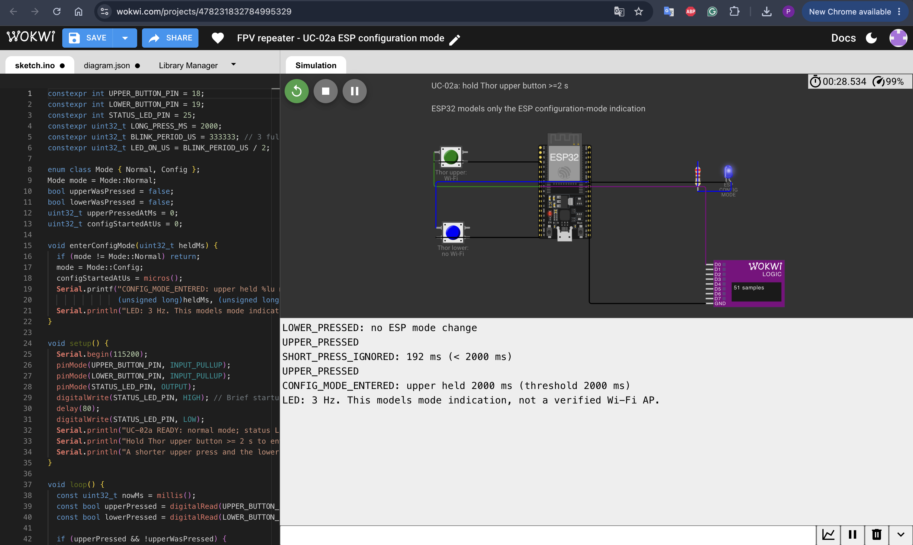

# Wokwi-модель: UC-02a — вхід ESP у режим налаштування

**Онлайн-модель:** [FPV repeater — UC-02a ESP configuration mode](https://wokwi.com/projects/478231832784995329)

Модель відтворює **перший етап UC-02 і FR-02** з [PRD.md](PRD.md): після утримання верхньої кнопки Thor щонайменше 2 секунди ESP переходить у режим налаштування. Поріг - 2 секунди, блимання індикатора з частотою 3 Гц.

## Склад моделі

- ESP32 імітує лише логіку входу ESP у режим налаштування. У реальному пристрої використовується ESP-01S.
- Зелена кнопка **Thor upper** імітує верхню кнопку Thor; синя **Thor lower** потрібна для негативної перевірки.
- Синій LED показує стан: короткий спалах після запуску, потім вимкнений; після входу в режим налаштування блимає приблизно 3 рази за секунду.
- Logic Analyzer підключений до лінії LED, щоб бачити періодичне перемикання сигналу.

## Як перевірити

1. Відкрити модель і натиснути **Start the simulation**. LED коротко спалахне й згасне; у Serial Monitor з’явиться повідомлення про готовність.
2. Натиснути нижню кнопку **Thor lower**. У журналі з’явиться `LOWER_PRESSED: no ESP mode change`; режим налаштування не запускається.
3. Коротко натиснути верхню кнопку **Thor upper**. У журналі з’явиться `SHORT_PRESS_IGNORED`; режим не зміниться.
4. Затиснути кнопку **Thor upper** щонайменше на 2 секунди. У журналі з’явиться `CONFIG_MODE_ENTERED`, а LED почне блимати.

**Межа симуляції:** повідомлення `CONFIG_MODE_ENTERED` та LED означають зміну змодельованого стану. Модель не запускає справжню точку Wi‑Fi, не відкриває сторінку налаштувань, не зберігає binding phrase й не перевіряє автоматичне з’єднання з пультом. Ці кроки UC-02 потребують реального обладнання або окремої моделі.

## Скріншот роботи

*Рисунок 1 — результат симуляції UC-02a у Wokwi: після утримання верхньої кнопки щонайменше 2 с у Serial Monitor зафіксовано перехід ESP у режим налаштування; LED показаний у ввімкненій фазі блимання.*
